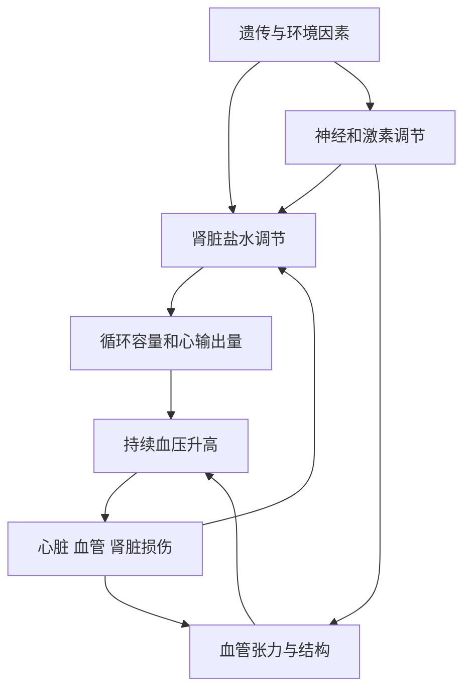

# 高血压为什么发生：机制与研究导读

整理日期：2026-11-02。阅读目标：理解机制、证据和病因排查；不根据一个数字自我诊断。定向检索，非系统综述。个人判断另存private，不在本文记录个人信息。

## 1. 先区分三个问题

- **机制**：血压通过什么生理过程升高，例如血管收缩、肾脏保钠。
- **危险因素**：什么使发生概率增加，例如遗传背景、盐摄入、超重；它们不等于某个人已被确认的病因。
- **具体病因**：可识别的疾病或药物作用，例如原发性醛固酮增多症。

原发性（本态性）高血压通常是多个因素与调节系统共同作用，没有一个可单独解释的疾病；继发性高血压由可识别的疾病或药物等引起。两者可以与不利生活因素同时存在。“原发性”不是“没有生物学原因”，也不等于“只是情绪问题”。[C1][C2]

## 2. 血压调节的基本框架

把循环理解为泵、弹性管路、阻力和容量：心脏推动血流；小动脉收缩/舒张改变阻力；大动脉弹性缓冲脉动；肾脏调节盐水总量。简化关系为 **平均动脉压－右心房压＝心输出量×全身血管阻力**。这是理解关系的生理近似，不是用来直接预测高压或低压的公式。[C3]

高压、低压都受多个因素影响，不能把高压简单归给心脏、低压归给肾脏。舒张压也受到外周阻力、心率和动脉弹性等影响；“低压高”不能直接诊断交感神经兴奋或某种肾病。[C3]

图为多来源机制概括，箭头不表示每个人都有该通路，也不表示作用大小已被量化。[C3–C5]

## 3. 肾脏：长期盐水平衡的关键

肾脏决定摄入的钠和水怎样排出。盐水潴留能影响循环容量；一些高血压机制中，需要更高压力才能维持钠排泄平衡。高血压又会损伤肾脏，形成双向关系。[C4]

Crowley等通过小鼠肾交叉移植与受体敲除，区分肾内和肾外血管紧张素II受体作用，发现肾脏受体对该模型升压至关重要。[C5] 这是机制实验，不是“所有高血压都是肾病”的证明，更不说明正常肌酐即可排除调节异常。

## 4. 激素：RAAS与醛固酮

RAAS是肾素—血管紧张素—醛固酮系统。它能通过血管收缩与肾脏钠水处理影响血压；正常情况下参与维持灌注，但不适当激活可参与升压。[C5]

原发性醛固酮增多症是特定的继发原因：肾上腺醛固酮分泌相对自主，促进肾脏保钠、容量增加；并非人人有低血钾。2025内分泌学会指南对全部高血压人群提出筛查的条件性建议，是否实施结合资源和临床判断。筛查用醛固酮、肾素及其比值，血钾帮助解释。[C6]

不能自行停药或突击改盐量准备检查：药物、血钾、采血条件会影响结果，听从医生/检验科要求。[C6]

## 5. 为什么体重和睡眠会参与

超重不是简单让心脏“多带几公斤”。AHA科学声明讨论了交感神经、RAAS及肾脏周围脂肪等对钠重吸收的影响；各机制对不同人的贡献不同。不能按BMI推算某个人多少血压由体重造成。[C7]

睡眠呼吸暂停的研究应与普通夜醒分开看：2000年前瞻队列观察到睡眠呼吸紊乱与后续高血压相关，但观察研究仍可能存在混杂。[C8]
2014 HeartBEAT随机试验比较CPAP、夜间氧疗和教育对照；318人随机化，281人有完整动态血压，12周时CPAP组24小时平均动脉压较对照低2.4mmHg（95%CI −4.7至−0.1），氧疗无相同效果。[C9] 说明研究中的获益不能简单归为“只要补氧就行”，也不能外推为普通夜醒需要呼吸机。这个终点不是舒张压，不能混读。

## 6. 遗传：易感性不等于命运

2024年超过百万欧洲血统成人的全基因组关联研究发现大量血压相关信号，支持多基因参与。[C10] 但关联位点不等于已证实的致病机制，欧洲人群风险评分不能直接照搬到中国个人，也不是常规就诊必须做基因检测的理由。

## 7. 哪些具体原因值得和医生讨论

| 类别 | 可能线索或作用 | 注意事项 |
|---|---|---|
| 肾实质疾病 | 尿蛋白/血尿、肾功能异常、相关病史 | 高血压也会造成肾损伤，需要辨别方向 [C4] |
| 原发性醛固酮增多症 | 低血钾、较重/难治高血压等；也可无低钾 | 正常血钾不能排除，检查需规范 [C6] |
| 睡眠呼吸暂停 | 响亮打鼾、呼吸暂停、喘醒 | 不必同时有白天困倦；必要时睡眠检查 [C11] |
| 甲状腺等内分泌问题 | 相应病史、体征、化验线索 | 不因一次偏高就做所有激素检查 [C1] |
| 药物和物质 | 部分止痛药、减充血感冒药、兴奋剂等 | 列出所有药物和补充剂供医生核对，不擅停处方 [C1] |

40岁以下确认高血压时，NICE建议考虑专科继发病因评估。[C12] 不等于人人需要全部影像/激素检查；医生结合病史、查体、基础血尿检查选择下一步。

## 8. 怎样读懂“成因研究”

| 研究类型 | 更适合回答 | 不能直接回答 |
|---|---|---|
| 细胞/动物干预 | 某通路在特定模型是否有因果作用 | 个人是否由此致病、用药剂量 |
| 人群队列 | 暴露是否先于疾病、是否有相关性 | 完全排除混杂、个人归因比例 |
| GWAS | 哪些遗传变异与血压相关 | 每个位点必然致病、跨人群准确预测 |
| 随机试验 | 某措施对特定人群及终点的平均作用 | 所有人反应相同、效果证明唯一病因 |
| 临床指南 | 怎样综合证据安排评估与治疗 | 未经检查替个人确诊 |

研究显示“减盐有效”，不等于每个高血压患者都吃盐过多；药物降低血压，也不表示人体缺少那种药物。控制血压与寻找病因可以同时进行，不必等所有病因检查结束才治疗。

## 9. 建议阅读路线

1. **入门**：C1、C2、C4，先理解危险因素与原发/继发的区别。
2. **机制**：C3、C5、C7，理解阻力、容量、肾脏与神经激素之间的联系。
3. **证据判断**：C8、C9、C10，对比队列、随机试验与遗传研究。
4. **就诊讨论**：C6、C12，把研究问题转为适合自身的排查问题。

完整书目和核对范围见[带注释的阅读清单](hypertension-causes-reading-list.md)。本文不支持根据读数反推个人病因。

## 数据补充

见[6项量化研究结论](hypertension-causes-data.md)，包含样本量、效应、置信区间和研究局限。
